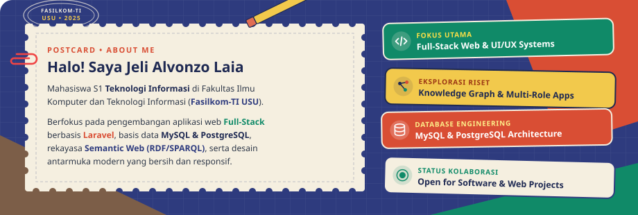
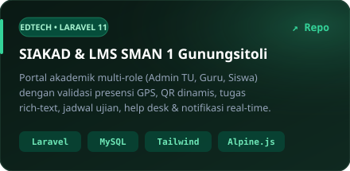
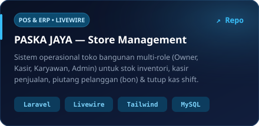
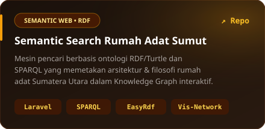
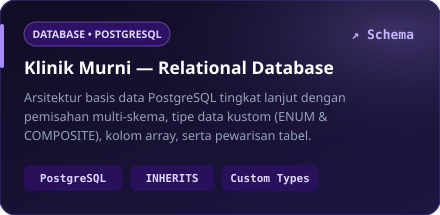

  

 

### ⚡ `01.` About & Engineering Focus

  

### 🛠️ `02.` Tech Stack & Tools

  
<b>Languages &amp; Query</b>

  

    
    
    
    
    
    
  

  
<b>Frameworks &amp; Libraries</b>

  

    
    
    
    
  

  
<b>Databases, Design &amp; Engineering Tools</b>

  

    
    
    
    
    
    
    
  

 

### 🚀 `03.` Featured Projects

  
  
   
  
  

### 📊 `04.` GitHub Telemetry & Activity

  
  

  

 

  

 

### 🌐 `05.` Let's Connect

  
  
  
  

 

  

