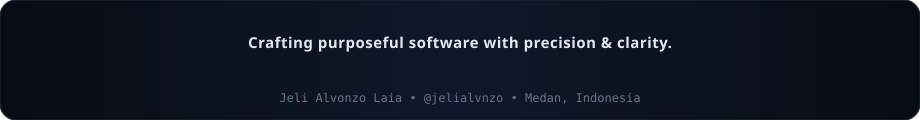

  

 

### ⚡ `01.` About & Engineering Focus

<table>
  <tr>
    <td width="55%" valign="top">
      

        Halo! Saya <b>Jeli Alvonzo Laia</b>, mahasiswa S1 <b>Teknologi Informasi</b> di <i>Fakultas Ilmu Komputer dan Teknologi Informasi (Fasilkom-TI), Universitas Sumatera Utara</i>.
      

      

        Saya berfokus pada pengembangan aplikasi web <i>full-stack</i> berbasis <b>Laravel</b>, perancangan basis data relasional (<b>MySQL &amp; PostgreSQL</b>), rekayasa <b>Semantic Web (RDF/OWL/SPARQL)</b>, serta desain antarmuka modern yang bersih, responsif, dan berorientasi pada pengalaman pengguna.
      

    </td>
    <td width="45%" valign="top">
      <ul>
        <li>💻 <b>Fokus Utama:</b> Full-Stack Web Development &amp; UI/UX Systems.</li>
        <li>🧠 <b>Eksplorasi:</b> Knowledge Graph, Ontology Engineering, &amp; Arsitektur Aplikasi Multi-Role.</li>
        <li>🎓 <b>Komunitas:</b> Google Developer Group on Campus (GDGoC) USU — UI/UX Path.</li>
        <li>🤝 <b>Status:</b> Terbuka untuk kolaborasi proyek perangkat lunak &amp; pengembangan web.</li>
      </ul>
    </td>
  </tr>
</table>

 

### 🛠️ `02.` Tech Stack & Tools

  
<b>Languages &amp; Query</b>

  

    
    
    
    
    
    
  

  
<b>Frameworks &amp; Libraries</b>

  

    
    
    
    
  

  
<b>Databases, Design &amp; Engineering Tools</b>

  

    
    
    
    
    
    
    
  

 

### 🚀 `03.` Featured Projects

<table>
  <tr>
    <td width="50%" valign="top">
      <h4>🏫 <a href="https://github.com/jelialvonzolaia-sys/siakad-sekolah">SIAKAD &amp; LMS SMA Negeri 1 Gunungsitoli</a></h4>
      
Sistem Informasi Akademik &amp; Learning Management System multi-role (Admin TU, Guru, Siswa) dengan validasi presensi GPS &amp; QR Code dinamis, tugas rich-text, jadwal ujian, help desk, dan notifikasi real-time.

      <code>Laravel 11</code> • <code>MySQL</code> • <code>Tailwind CSS</code> • <code>Alpine.js</code>
    </td>
    <td width="50%" valign="top">
      <h4>🏪 <a href="https://github.com/Chalbn/PASKA-JAYA">PASKA JAYA — Store Management System</a></h4>
      
Aplikasi manajemen operasional toko multi-role (Owner, Kasir, Karyawan, Admin) untuk pengelolaan stok barang, transaksi penjualan, pencatatan piutang pelanggan (bon), dan rekonsiliasi kas shift.

      <code>Laravel</code> • <code>Livewire</code> • <code>Tailwind CSS</code> • <code>MySQL</code>
    </td>
  </tr>
  <tr>
    <td width="50%" valign="top">
      <h4>🏛️ <a href="https://github.com/jelialvonzolaia-sys/rumah-adat-sumut">Semantic Search Rumah Adat Sumatera Utara</a></h4>
      
Mesin pencari berbasis teknologi Web Semantik (RDF/Turtle &amp; SPARQL) yang memetakan arsitektur, filosofi, dan wilayah rumah adat di Sumatera Utara dalam bentuk <i>Knowledge Graph</i> interaktif.

      <code>Laravel</code> • <code>SPARQL / EasyRdf</code> • <code>Vis-Network</code>
    </td>
    <td width="50%" valign="top">
      <h4>🏥 <a href="https://github.com/jelialvonzolaia-sys">Klinik Murni — Relational Database Architecture</a></h4>
      
Perancangan arsitektur basis data PostgreSQL tingkat lanjut dengan pemisahan multi-skema, tipe data kustom (<code>ENUM</code> &amp; <code>COMPOSITE</code>), kolom array, serta pewarisan tabel (<code>INHERITS</code>).

      <code>PostgreSQL</code> • <code>SQL</code> • <code>Database Design</code>
    </td>
  </tr>
</table>

 

### 📊 `04.` GitHub Telemetry & Activity

  
  

  

 

  

 

### 🌐 `05.` Let's Connect

  
  
  
  

 

  

